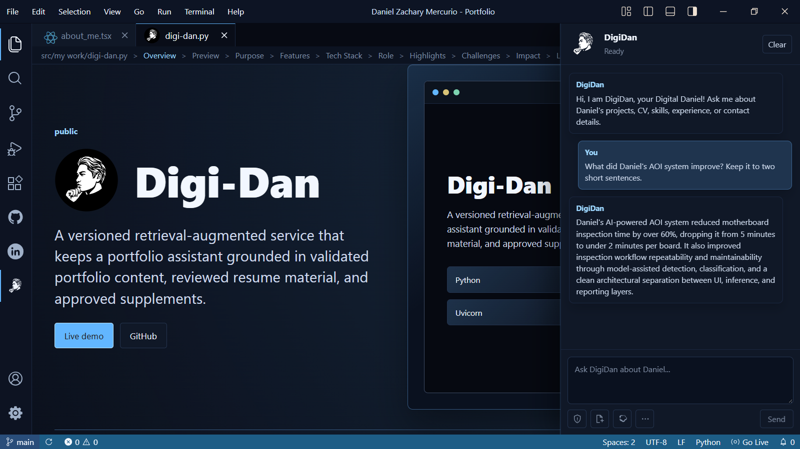
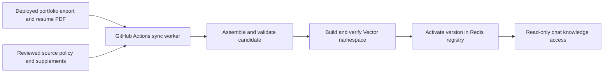

# Digi-Dan

<p align="left">A versioned, retrieval-grounded knowledge service for a portfolio assistant.</p>

<p align="left">
  
  
  
  
  
  
</p>

<p align="center">
  
</p>

## Navigate

[What it does](#what-it-does) · [UI example](#ui-example) · [Architecture](#architecture) · [Quick start](#local-setup) · [API](#api-reference) · [Operations](#operations) · [Security](#security-and-troubleshooting) · [Documentation](#documentation)

## What it does

Digi-Dan keeps the portfolio assistant aligned with reviewed portfolio content. A sync workflow assembles a versioned knowledge package from the portfolio export, reviewed resume content, and approved supplements. It validates and prepares a complete version before activation, preserving the last good version if a candidate fails. Relevant source pushes and production deployments trigger sync; a scheduled run provides periodic reconciliation. This is eventual periodic freshness, not an instant update guarantee. Resume changes and designated source conflicts remain behind review.

Portfolio information is useful only when visitors can find it. Digi-Dan turns approved profile, education, project, skill, and experience data into answerable context: retrieve facts first, generate a response second, and return the evidence supplied to generation for review and debugging.

It can also be adapted into a resume bot, documentation assistant, or small knowledge-base chatbot.

| Area | What the project demonstrates |
| --- | --- |
| Responses | Gemini or DeepSeek generation returns an answer, provider, and source records. |
| Knowledge | Version validation and controlled activation keep incomplete candidates away from the active knowledge set. |
| Grounding | Gemini embeddings retrieve relevant chunks; answer generation can use Gemini or DeepSeek with eligible fallback. |
| Continuity | Bounded follow-up history is sent with each request; retrieved evidence is refreshed for every question. |
| Safety | A portfolio server proxy supplies trusted identity; Upstash Redis enforces a shared network-based limit. |
| Deployment | Production uses versioned knowledge and shared Redis enforcement; local defaults remain suitable for development. |

**Live demo:** [Digi-Dan portfolio chat](https://zachcodes.vercel.app)

## UI example

The chat interface below is an example of the portfolio-facing experience. A visitor asks a question while Digi-Dan retrieves relevant context and returns a response with records of the source chunks supplied to generation.



## Architecture

### Chat request flow

```mermaid
flowchart LR
    B[Browser] -->|POST /api/digi-dan| P[Portfolio server proxy]
    P -->|Secret and HMAC client ID| A[Digi-Dan POST /api/chat]
    A --> L[Authenticate and check shared Redis quota]
    L --> K[Resolve active knowledge version]
    K --> E[Gemini query embedding]
    E --> V[Versioned Upstash Vector retrieval]
    V --> C[Bounded evidence and conversation history]
    C --> G[Gemini or DeepSeek generation]
    G --> R[Answer, provider, sources and version]
    R --> P
    P --> B
```



### Knowledge updates



The worker owns knowledge writes. The chat runtime reads the active version with restricted credentials and uses a separate limiter credential for quota updates. See [architecture](docs/architecture.md) for the request and trust boundaries.

Important files:

```txt
app.py                                  Vercel/Uvicorn ASGI entrypoint
api/endpoint/application.py             FastAPI app, middleware, routes
api/core/config.py                      Environment variable loading
api/core/models.py                      Request and response models
api/core/prompts.py                     Default system prompt
api/query/rag.py                        Retrieval and prompt assembly
api/query/generation.py                 Provider selection and eligible fallback
api/knowledge/                          Versioned knowledge stores and registry
api/tools/knowledge_sync.py             Source assembly, version builds, verification, activation
api/tools/rate_limit.py                 Memory and Redis rate-limit backends
api/tools/vector_store.py               Upstash Vector query/upsert helpers
api/tools/upload_vectorstore.py         Legacy CLI uploader, compatibility use only
knowledge/source-policy.json           Reviewed source ownership and supplemental facts
.github/workflows/sync-knowledge.yml     Production reconciliation workflow
```

## Local setup

For a new local checkout, copy `.env.example` to `.env` (`Copy-Item .env.example .env` on PowerShell) and fill in the required settings. Keep it as plain `KEY=value` lines only. The example defaults to legacy knowledge and memory limiting; it does not reproduce production. Follow [production integration](docs/production-integration.md) and [shared rate limiting](docs/shared-rate-limiting.md) for versioned runtime configuration. Keep an existing environment intact when updating a checkout.

```powershell
python -m venv .venv
.\.venv\Scripts\Activate.ps1
python -m pip install -r requirements.txt
uvicorn app:app --reload --port 8001
```

On macOS/Linux, activate with `source .venv/bin/activate`. Test health with:

```powershell
Invoke-RestMethod -Uri "http://127.0.0.1:8001/api/health" -Headers @{ "X-API-Secret" = "YOUR_API_BYPASS_SECRET" }
```

Production chat uses the active knowledge version. Responses include its `knowledge_version` and source records for chunks supplied as evidence; these are whole chunks rather than statement-level citations.

## API reference

### `GET /`

Basic root check:

```json
{ "name": "Digi-Dan", "status": "ok" }
```

### `GET /api/health`

Health check for local, Vercel, or uptime monitoring. Protected by the same origin/bypass middleware as other `/api/*` routes.

### `GET /api/knowledge/status`

Reports knowledge mode and active-version readiness using the registry. It does not test model generation, Vector queries, or limiter availability. It uses the same origin/API-secret middleware as the health route.

### `POST /api/chat`

```json
{
  "message": "What technologies did that project use?",
  "top_k": 4,
  "history": [
    { "role": "user", "content": "Tell me about the Wistron AOI system." },
    { "role": "assistant", "content": "Daniel worked on the Wistron AOI system." }
  ]
}
```

In production, the portfolio server sends both `X-API-Secret` and `X-DigiDan-Client-Id`; an allowed Origin alone cannot authorize chat.

`message` is required, nonblank, and limited to 2,000 Unicode characters. Omit `provider` (or use `null`) for automatic generation starting with `DEFAULT_PROVIDER`; an eligible temporary failure can use the other provider once. Explicit `provider: "gemini"` or `"deepseek"` pins the request to that provider without fallback. `top_k` is optional. Public callers cannot override the system prompt or select a namespace. See [provider fallback](docs/provider-fallback.md) for failure handling and deadlines.

`history` is optional and defaults to an empty list. It contains prior completed user/assistant pairs, oldest first: at most eight messages, 2,000 Unicode characters per message and 8,000 characters in total. Each item contains only `role` and `content`. Invalid roles, incomplete pairs, blank content and oversized histories are rejected. History helps interpret follow-ups; it is not verified evidence. Each question still retrieves current knowledge. Source records identify whole chunks supplied to generation; they do not establish support for every generated statement. See [conversation continuity](docs/conversation-continuity.md).

Illustrative response shape (source text and version abbreviated):

```json
{
  "answer": "Daniel studied at President Ramon Magsaysay State University...",
  "provider": "gemini",
  "knowledge_version": "<captured-version-id>",
  "sources": [{ "id": "education-college", "score": 0.8238814, "text": "Daniel's college education...", "metadata": { "section": "education", "topic": "college" } }]
}
```

### `POST /api/ingest`

Legacy compatibility endpoint, disabled with HTTP 409 in versioned mode. In legacy mode it uploads documents into Upstash Vector and requires `Authorization: Bearer BOT_ADMIN_TOKEN` in addition to the API origin/secret middleware. Production updates use the synchronization worker.

```json
{ "namespace": "digi-dan-rag", "documents": [{ "id": "education-college", "text": "Daniel studied Computer Engineering...", "metadata": { "section": "education" } }] }
```

## Configuration

| Variable | Purpose |
| --- | --- |
| `APP_NAME`, `PORTFOLIO_OWNER_NAME` | API display name and trusted owner name used in the system prompt. |
| `CORS_ORIGINS`, `ALLOWED_ORIGIN_DOMAINS` | Browser CORS and custom-origin allowlists. |
| `API_BYPASS_SECRET` | Trusted terminal/server `X-API-Secret`; never expose it in browser code. |
| `GEMINI_API_KEY`, `GEMINI_MODEL`, `GEMINI_EMBEDDING_MODEL` | Gemini API credential, generation model (default `gemini-3.5-flash-lite`), and embedding model (default `gemini-embedding-001`). |
| `EMBEDDING_DIMENSIONS` | Must match the Upstash Vector index dimension; default `768`. |
| `DEEPSEEK_API_KEY`, `DEEPSEEK_BASE_URL`, `DEEPSEEK_MODEL` | DeepSeek generation settings. |
| `UPSTASH_VECTOR_REST_URL`, `UPSTASH_VECTOR_REST_TOKEN` | Vector access. Versioned retrieval selects the namespace through the registry. |
| `UPSTASH_NAMESPACE` | Legacy namespace only; not the production active-version selector. |
| `KNOWLEDGE_MODE`, `KNOWLEDGE_ENVIRONMENT` | Local defaults are `legacy` and `test`; production sets `versioned` and `production`. |
| `UPSTASH_REDIS_REST_URL`, `UPSTASH_REDIS_REST_TOKEN` | Runtime registry access; production runtime uses read-only credentials, while sync workers use separate write credentials. |
| `BOT_ADMIN_TOKEN` | Ingest-route Bearer token. |
| `DEFAULT_PROVIDER`, `RETRIEVAL_TOP_K`, `MAX_CONTEXT_CHARS` | Generation and retrieval defaults. |
| `GENERATION_FALLBACK_ENABLED` | Allow the other generation provider after an eligible failure on an automatic request; default `true`. |
| `GENERATION_TIMEOUT_SECONDS`, `GENERATION_TOTAL_TIMEOUT_SECONDS` | Per-attempt and shared generation deadlines in seconds; default `20` and `40`. Retrieval time is separate. |
| `CHAT_RATE_LIMIT`, `CHAT_RATE_LIMIT_WINDOW_SECONDS` | Per-client fixed-window chat allowance; defaults 10 and 3600. Zero is allowed only with memory mode. |
| `CHAT_RATE_LIMIT_BACKEND`, `CHAT_CLIENT_IDENTITY_MODE` | Defaults `memory`/`legacy` for local use; production uses shared `redis`/`trusted_proxy` enforcement. |
| `RATE_LIMIT_REDIS_REST_URL`, `RATE_LIMIT_REDIS_REST_TOKEN`, `RATE_LIMIT_REDIS_TIMEOUT_SECONDS` | Separate restricted limiter connection; two-second timeout by default. See [shared rate limiting](docs/shared-rate-limiting.md). |

## Testing

Run the isolated regression suite from the repository root after installing the core dependencies and the `pypdf` version pinned in `requirements-resume.txt`. The isolated tests mock OCR and do not require Tesseract, Pillow, or a live PDF renderer:

```powershell
.\.venv\Scripts\python.exe scripts/run_tests.py
```

Test modules live in `scripts/tests/` and are named by behavior, such as knowledge synchronization, conversation continuity, provider fallback, and rate limiting. The runner blocks outbound network connections, including attempts caught by application code, and uses simulated cloud services without consuming API quota.

To focus on a component:

```powershell
.\.venv\Scripts\python.exe scripts/run_tests.py --pattern "test_probe_cache.py"
```

`scripts/run_redis_checks.py` is a separate, opt-in integration check for a new, empty Redis server bound to `127.0.0.1`. It writes synthetic data and creates a test ACL user; never point it at a shared or production database. Run it with `--help` for its port and report options. It is not part of the isolated suite.

## Operations

### Versioned knowledge synchronization

The production workflow assembles knowledge from the portfolio's validated export, reviewed resume extraction, and approved supplements. It validates a candidate, builds it in a separate namespace, verifies readiness, and activates it only after checks pass. Candidate failures before activation leave the last good version active. If activation has already been attempted, reports distinguish confirmed activation from an uncertain outcome. Pushes and production deployment events trigger sync, with scheduled periodic reconciliation; scheduling is best effort and does not promise hourly freshness. Resume changes and designated conflicts require review before they can enter the active knowledge.

`GET /api/knowledge/status` reports the active knowledge registry state only, not model, vector-query, or limiter health. Chat responses include the active version; requests do not accept a version selector. See [production setup](docs/production-integration.md).

### Legacy direct ingestion

The CLI uploader and `POST /api/ingest` remain compatibility paths for legacy/manual use. In production, versioned synchronization is the primary knowledge path. The legacy API responds `409` when versioned knowledge mode is active. Do not use direct uploads to bypass review or version activation.

```bash
python -m api.tools.upload_vectorstore daniel-zachary-rag-data.json --namespace digi-dan-rag
```

The legacy upload workflow skips when the repository variable `KNOWLEDGE_MODE=versioned`. It is not the production update workflow.

The uploader supports `.json` (`{"documents": [...]}` or a raw document array), `.jsonl` (one document object per line), and `.txt` (one document).

### Vercel deployment

The root `app.py` exposes the ASGI app. Use Vercel's **FastAPI** preset, repository root, and default/empty build, install, and output settings. Add the same production configuration values; `DEEPSEEK_API_KEY` is needed only when DeepSeek generation is enabled.

### Using it from a portfolio

Proxy browser requests through the portfolio backend. It attaches `X-API-Secret` and a server-generated HMAC client identity in `X-DigiDan-Client-Id`; neither secret nor identity key belongs in browser code. Production requires this trusted identity and applies a shared 10 requests per hour network-based limit in Upstash Redis. See [shared rate limiting](docs/shared-rate-limiting.md).

### Using this as a template

1. Fork or copy the repository and configure `APP_NAME` and `PORTFOLIO_OWNER_NAME`.
2. Provide a compatible portfolio export and resume source. Review `knowledge/source-policy.json`, supplemental evidence, and retrieval probes for your own content; do not reuse another person's review hashes or facts.
3. Create an Upstash Vector index matching the embedding dimensions and a Redis registry. Configure separate knowledge reader, worker, and restricted limiter credentials.
4. Prepare and review resume evidence, assemble a candidate, and validate it locally using the [assembly](docs/knowledge-assembly.md) and [versioning](docs/knowledge-versioning.md) guides.
5. Follow [production integration](docs/production-integration.md) to verify deployed sources, prepare and activate a version, and configure the trusted portfolio proxy.
6. Enable [synchronization](docs/knowledge-sync.md) after hosted checks pass. Legacy ingestion remains available for deliberately chosen compatibility deployments.

## Security and troubleshooting

- Do not commit `.env`, expose `API_BYPASS_SECRET` or `BOT_ADMIN_TOKEN`, or make `/api/ingest` a public browser operation.
- `Forbidden origin`: configure the portfolio origin. In trusted-proxy mode a valid Origin alone does not establish trusted client identity.
- `GEMINI_API_KEY is not configured`: Gemini is needed for embeddings even when DeepSeek generates the answer.
- Unexpected answers: check the authoritative source and policy, inspect returned source chunks, and review sync validation and active-version status.
- Vercel unmatched function pattern: use the FastAPI preset and root `app.py`; do not add stale function patterns.

## Documentation

- [Documentation home](docs/index.md)
- [Architecture and trust boundaries](docs/architecture.md)
- [Shared rate limiting and trusted client identity](docs/shared-rate-limiting.md)
- [Production knowledge synchronization](docs/knowledge-sync.md)
- [Production setup](docs/production-integration.md)
- [Legacy corpus and format reference](daniel-zachary-rag-data.json)
- [Portfolio showcase metadata](portfolio-showcase.json)

## License

See [LICENSE](LICENSE).
