# Runtime architecture

Production chat uses versioned knowledge retrieval, trusted portfolio identity, and a Redis-backed shared limiter. The limiter uses a separate restricted Redis credential from the read-only knowledge registry credential.

```mermaid
flowchart LR
    Browser[Portfolio chat in browser] -->|message and bounded history| Proxy[Portfolio server route]
    Proxy -->|X-API-Secret plus opaque HMAC client ID| API[FastAPI POST /api/chat]
    API --> Auth[Validate secret, identity, request]
    Auth --> Limit[Atomic Redis rate-limit decision]
    Limit --> Retrieve[Resolve active version and retrieve]
    Retrieve -->|Gemini embedding| Embed[Gemini embeddings]
    Embed --> Vector[Versioned Upstash Vector]
    Vector --> Evidence[Retrieved evidence and source records]
    Evidence --> Generate[Gemini or DeepSeek generation]
    Generate --> API
    API --> Proxy
    Proxy --> Browser
```

The browser never receives the backend API secret or HMAC key. It calls the portfolio route, which discards browser-supplied internal identity headers, derives an opaque 64-character lowercase hexadecimal HMAC-SHA256 identity from the trusted Vercel ingress IP, and sends that identity with `X-API-Secret`. Digi-Dan chat requires both a valid secret and identity in `trusted_proxy` mode. An allowed Origin by itself is not authentication.

## Chat request path

1. The browser submits a current question and up to four recent complete user/assistant exchanges. See [conversation continuity](conversation-continuity.md) for validation and prompt boundaries.
2. The portfolio proxy authenticates its server-to-server request to Digi-Dan. Digi-Dan validates the chat payload and both trusted headers before consuming one rate-limit allowance.
3. The production limiter atomically admits or denies the opaque identity in Redis. A denial returns 429; a limiter error fails closed with 503. No retrieval or generation runs on either path. See [shared rate limiting](shared-rate-limiting.md).
4. The backend resolves the active knowledge version once, builds a retrieval query (including bounded subject hints for recognized follow-ups), embeds it with Gemini, and queries the matching versioned Upstash Vector namespace.
5. It assembles retrieved evidence, separately labelled untrusted conversation history, the current question, and server-rendered trusted instructions. Generation uses the default provider and may make one eligible fallback attempt. Explicitly pinned providers do not fall back. See [provider fallback](provider-fallback.md).
6. The response identifies the answering provider and captured knowledge version and returns only complete source chunks actually supplied to generation. These records show supplied evidence; they are not sentence-level citations and do not prove every answer claim.

Gemini embeddings remain on the retrieval path even when DeepSeek is selected for generation. An embedding failure stops the request before generation; generation fallback does not cover retrieval failures.

## Operational limits

The 10-per-hour allowance is keyed by network-derived identity, not a person; shared networks share quota. Scheduled knowledge synchronization is best effort and does not guarantee hourly freshness. See [shared rate limiting](shared-rate-limiting.md) for identity and quota semantics.

## Knowledge lifecycle

Versioned knowledge is managed separately from chat rate limiting. The synchronization flow assembles portfolio facts, creates and validates a version, then activates it for retrieval; production chat uses the active version and does not write knowledge. The hourly schedule remains configured, but GitHub scheduling and reconciliation are periodic and do not guarantee hourly freshness. See the repository's [knowledge synchronization guide](knowledge-sync.md) for operational setup.

## Components

| Component | Responsibility |
| --- | --- |
| `app.py` | FastAPI ASGI entry point. |
| `api/endpoint/application.py` | Routes, middleware, chat orchestration boundary. |
| `api/query/rag.py` | Retrieval, evidence and prompt assembly. |
| `api/query/generation.py` | Provider selection, eligibility, deadlines and safe generation errors. |
| `api/knowledge/cloud.py`, `cloud_embeddings.py`, `cloud_vectors.py` | Production registry, Gemini embedding and versioned vector adapters. |
| `api/knowledge/versioning.py`, `production_staging.py`, `production_rollout.py` | Version validation, preparation and activation/rollback operations. |
| `api/tools/security.py` | Chat authentication and rate-limit admission. |
| `api/tools/rate_limit.py` | Redis limiter and compatibility memory/local implementations. |

## Compatibility and operations

Code defaults still include `memory` rate limiting and legacy identity behavior for local or compatibility deployments. Those defaults are not the production configuration and do not provide shared production enforcement. Production uses `CHAT_RATE_LIMIT_BACKEND=redis` and `CHAT_CLIENT_IDENTITY_MODE=trusted_proxy`; do not infer deployed settings from code defaults.

The versioned knowledge store is separate from the limiter keyspace and credentials. The dedicated limiter token is scoped to limiter keys and cannot read the knowledge registry. For knowledge synchronization, see [knowledge-sync.md](knowledge-sync.md); credential configuration is documented in [production-integration.md](production-integration.md).
