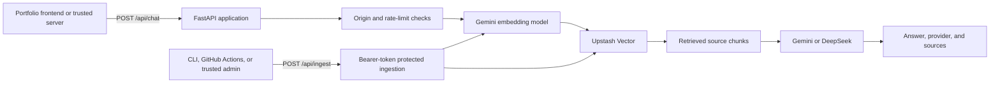

# Architecture

Digi-Dan is a small FastAPI service that combines vector retrieval with a selected text-generation provider. It is designed for a portfolio frontend or another trusted server to call rather than for browser code to hold privileged credentials.

## Request path

1. A caller sends a message to `POST /api/chat`, optionally selecting a generation provider, result count, and bounded prior conversation. Public namespace and system-prompt overrides are rejected.
2. The service applies origin rules, validates the request, and authenticates client identity before charging one allowance. In shared mode the portfolio sends an opaque HMAC identity with its server secret, and an atomic Redis operation coordinates all backend instances. An allowed Origin alone cannot bypass trusted identity. Limiter failure returns 503 before retrieval; exhaustion returns 429 with Retry-After. See [shared rate limiting](shared-rate-limiting.md) for compatibility modes and cutover.
3. For recognized follow-ups, Digi-Dan augments the retrieval question with bounded recent subject hints. Gemini embeds the resulting query. Upstash Vector returns current relevant chunks; the active knowledge version is resolved once per request.
4. Digi-Dan builds a grounded prompt with retrieved chunks, separately labelled untrusted conversation history and the current question. Automatic requests try the configured default generation provider, then the other provider once only after an eligible failure. Both attempts receive the same assembled prompt and captured evidence. Explicit provider selection disables fallback. History is not an authoritative fact source. The portfolio sends only one backend request.
5. The API returns the answer, provider, and only complete nonblank source chunks admitted to the generation context. The context budget counts IDs, text, and separators; chunks that do not fit are skipped while later chunks are still considered. Returned source text is the normalized text supplied to generation. These records identify supplied evidence; they do not prove that each answer claim is supported or cited.

Even when DeepSeek is selected for generation, Gemini remains necessary for the embedding path.

## Components

| Component | Responsibility |
| --- | --- |
| `app.py` | Imports and exposes the FastAPI application for Uvicorn and Vercel. |
| `api/endpoint/application.py` | Defines the root, health, chat, and ingest routes; registers CORS and origin middleware. |
| `api/query/rag.py` | Coordinates retrieval, prompt assembly, answer creation, and ingestion. |
| `api/query/providers.py` | Calls Gemini embeddings plus Gemini or DeepSeek generation. |
| `api/query/generation.py` | Owns generation fallback, shared deadline, safe failure diagnostics and public errors. |
| `api/tools/vector_store.py` | Queries and upserts data in Upstash Vector. |
| `api/tools/security.py` | Applies origin/bypass handling, admin-token checks, and chat rate limiting. |
| `api/tools/rate_limit.py` | Owns atomic Redis allowance decisions and isolated local memory counters. |
| `api/tools/upload_vectorstore.py` | Loads JSON, JSONL, or text files for vector ingestion. |

## Trust boundaries

- Origin rules are not authentication. In `trusted_proxy` mode chat requires the server secret and validated client ID even for an allowed Origin.
- `X-API-Secret` is a trusted server or terminal bypass. It must never be sent from browser JavaScript.
- `POST /api/ingest` requires `Authorization: Bearer BOT_ADMIN_TOKEN`; treat it as an administrative operation.
- Gemini, DeepSeek, and Upstash credentials stay in local, deployment, and automation environment variables rather than the repository.

## Deployment and data operations

The root ASGI entrypoint supports local Uvicorn development and Vercel's FastAPI deployment flow. The included GitHub Actions workflow can upload the RAG data after relevant changes on `main`; it needs the Gemini and Upstash repository secrets described in the [README](../README.md#github-actions-rag-upload).

The vector index dimension must match `EMBEDDING_DIMENSIONS`. Keep each knowledge-base document focused, use stable IDs, include useful metadata, and add summary chunks for broad questions. See the [README's RAG data and upload section](../README.md#rag-data-and-upload) for examples and upload commands.

[TODO: Add a deployment diagram, supported environment matrix, or observability runbook if the project gains those operational requirements.]
