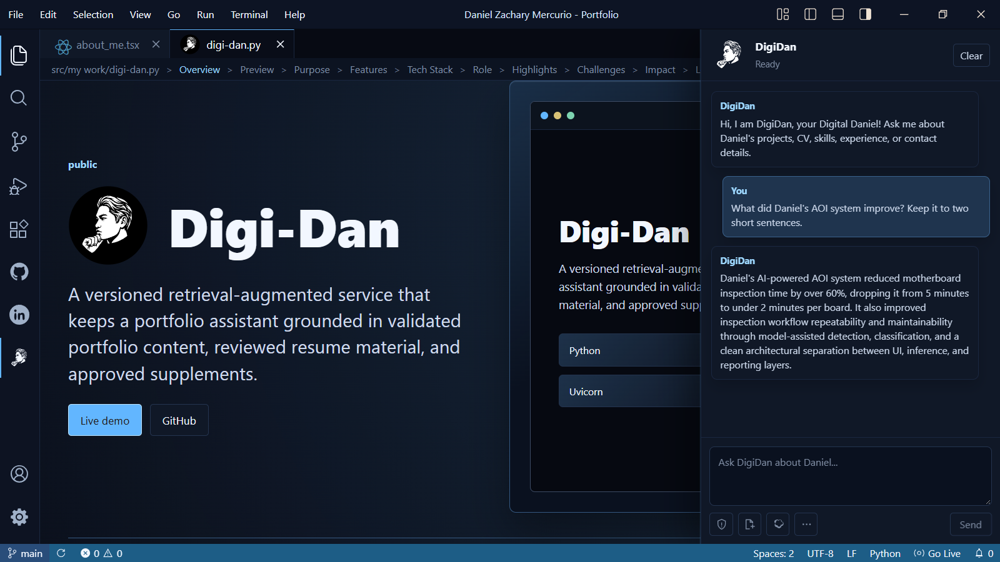

# Digi-Dan documentation

Digi-Dan is a retrieval-augmented generation (RAG) backend for a portfolio assistant. It accepts a question, retrieves relevant facts from an Upstash Vector knowledge base, and asks Gemini or DeepSeek to form a grounded answer. The response includes the matched source records.

## Start here

- Read the [project README](../README.md) for setup, endpoints, deployment, template use, security guidance, and troubleshooting.
- Read [Architecture](architecture.md) to understand the request path, components, and trust boundaries.
- Use [`daniel-zachary-rag-data.json`](../daniel-zachary-rag-data.json) as the included knowledge-base example and data-shape reference.

## What the repository contains

| Area | Purpose |
| --- | --- |
| `app.py` | ASGI entrypoint for Uvicorn and Vercel. |
| `api/endpoint/` | FastAPI application, routes, and middleware registration. |
| `api/query/` | RAG orchestration and generation-provider calls. |
| `api/tools/` | Vector-store access, security helpers, and the ingestion CLI. |
| `api/core/` | Settings, API models, and default prompt configuration. |
| `docs/assets/` | Repository-owned logo and screenshot used by the README and portfolio showcase. |

## Documentation maintenance

Keep product-specific details close to their source of truth. Update the README when endpoint behavior, required configuration, deployment, or security boundaries change. Update [`portfolio-showcase.json`](../portfolio-showcase.json) and its referenced assets when changing the public project story.

[TODO: Add a changelog or release-notes link if this project adopts one.]

## Resume preparation

[Resume PDF preparation](resume-import.md) documents change detection, local text/OCR extraction, quality checks and preservation of the last valid extraction before Stage 2 ownership migration.

## Knowledge assembly

[Stage 2 knowledge assembly](knowledge-assembly.md) describes source ownership, reviewed supplements, bounded chunks, candidate validation and the local command. [Migration inventory](knowledge-migration.md) records the disposition of all legacy documents.

## Versioned knowledge

[Stage 3 local versioning](knowledge-versioning.md) covers isolated staging, verification, activation, rollback, cleanup, chat integration and the remaining cloud integration milestone.

[Stage 3 cloud preparation](knowledge-cloud-tests.md) covers the isolated test Redis setup, cloud adapters, offline/read-only preflight, and the remaining live validation steps.

[Production integration](production-integration.md) describes source verification, runtime readiness and the controlled publication order.
